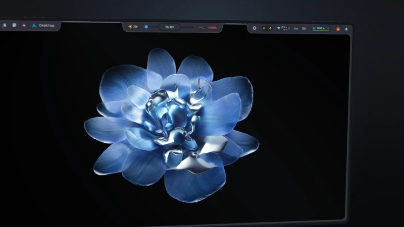
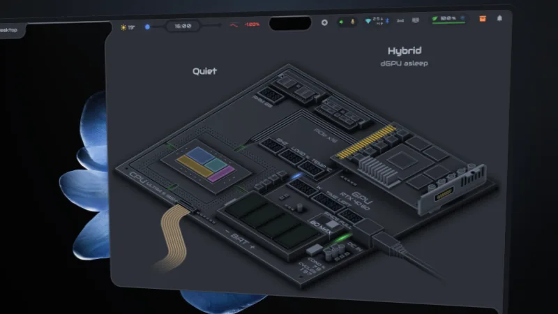
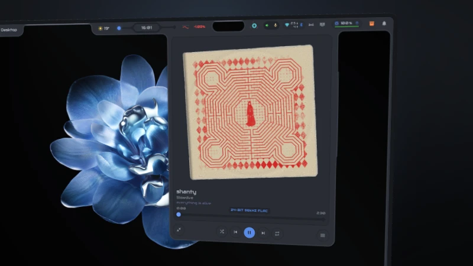
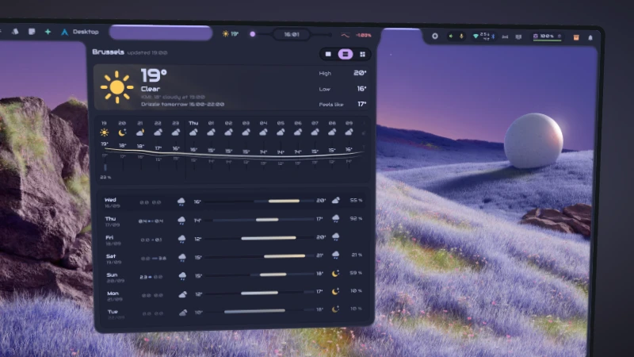
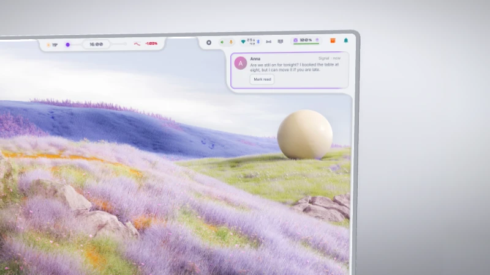
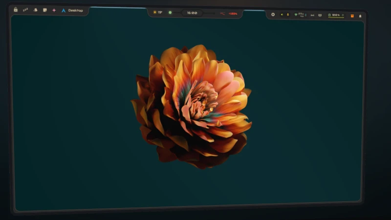
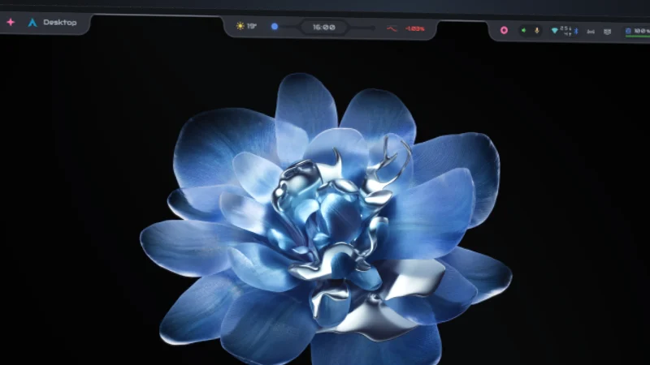
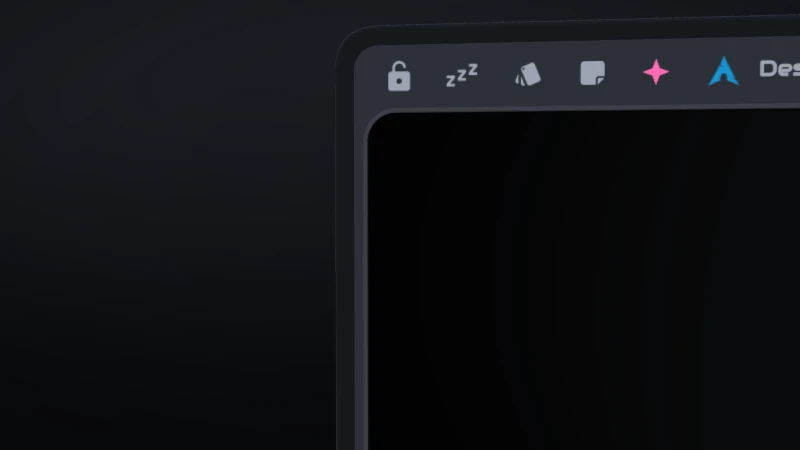
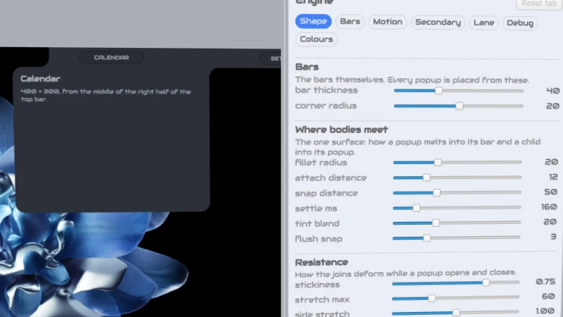
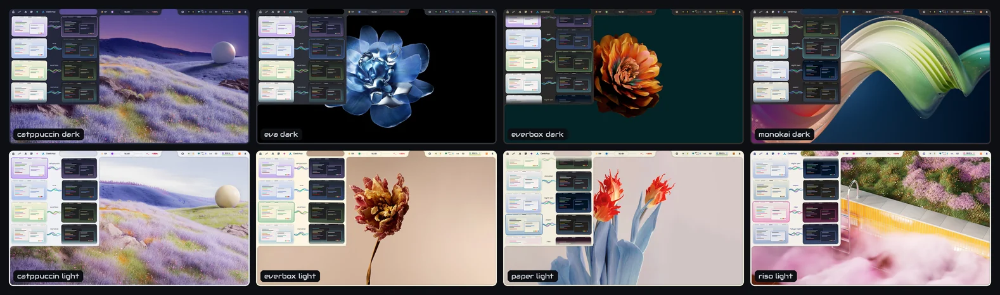

<!-- THE FILM, as the page's opening. Open this file in GitHub's web editor, drag film.mp4 onto the empty line below this comment
     and save: GitHub inserts a https://github.com/user-attachments/assets/... address there, which it shows as a video player.
     Then delete this comment. -->
<h1 align="center">Lares</h1>

https://github.com/user-attachments/assets/c2955673-0f40-43ab-8e89-5ed91cef8006

<p align="center">
  A complete desktop shell for <a href="https://hypr.land">Hyprland</a> on Arch Linux, written in QML on
  <a href="https://quickshell.org">Quickshell</a>.<br>
  Bars, popups, notifications, the lock screen, a launcher, a clipboard, an OSD and a polkit agent, drawn as one soft surface.
</p>

<p align="center">
  
  
  
  
</p>

<p align="center"><sub>The pictures on this page are the shell itself: its own QML, rendered frame by frame on mock data. The slab, the camera and
the captions are staging.</sub></p>

---

## Agentic AI-use disclosure

This project was heavily assisted by agentic AI tools. I guided agentic AI over the course of 4 months to get the project in this state. Everything you see, apart from this paragraph and the project's description, was either generated by or modified by the agents. This also means my personal understanding of the project is lower than I would want it to be. Making any signifiant changes to it would be challenging. As a result, maintaining this project is likely not a thing that will happen.

Since I let AI design Lares on my system's hardware, the project might not even work out of the box on yours. There are some tools in place, like `lares setup`, which try to guide a new install of this project. But in all honesty, when migrating the project from my laptop, to my desktop, I had some trouble getting everything working. This to say: your mileage may strongly vary.

> Note: The reason why Claude or any other agentic AIs are not contributors here, is due to privacy concerns. This public repository flows from a private one from which all secrets got stripped. That is why there are only a handful of commits here.

## What it is

This repository is the whole desktop around the windows: the bars, every popup, the notification server, the polkit agent, the
lock screen, the OSD, the clipboard and the theme are one configuration, so every part shares one look, one theme, one
scroll feel and one set of keys. **Lares** is its name (it was called "the Quickshell desktop shell" before); it is built on
Quickshell, whose `quickshell` binary and `~/.config/quickshell` directory it keeps: the checkout lives there.

- **One surface.** The bars and every popup are drawn by one shader as a single gooey surface: a popup grows out of the bar under
  its button, travels to the next button along the bar or round a corner, and folds back in.
- **One material.** Everything sits on the same surface: containers are carved into it, buttons stand proud of it, with the same
  light, colours and easings everywhere.
- **Light and dark, whole-desktop themes.** A theme switch crossfades the shell and re-themes the rest of the desktop (Hyprland,
  kitty, GTK, VS Code, btop, fastfetch, starship, hyprlock, the wallpaper) through `themectl`.
- **Live, but quiet.** Idle popups draw nothing; nothing polls faster than it must; there is a frame journal and a performance
  harness behind every claim.

## Modules

<table>
  <tr>
    <td width="50%" valign="top"><br><sub><b>One surface.</b> A popup grows out of the bar under its button and travels to the next one.</sub></td>
    <td width="50%" valign="top"><br><sub><b>Silicon.</b> The battery, the CPU profile and the GPU mode on a little motherboard.</sub></td>
  </tr>
  <tr>
    <td width="50%" valign="top"><br><sub><b>Player.</b> An mpd player: a record on a platter, the library, the queue.</sub></td>
    <td width="50%" valign="top"><br><sub><b>Weather.</b> A sky drawn for the weather, cards that change views, a chart behind every day.</sub></td>
  </tr>
  <tr>
    <td width="50%" valign="top"><br><sub><b>Notifications.</b> A lane of toasts, and a manager behind the bell.</sub></td>
    <td width="50%" valign="top"><br><sub><b>Launcher.</b> Alt+Space: rises from the bottom edge, searches as you type, throws what you pick.</sub></td>
  </tr>
  <tr>
    <td width="50%" valign="top"><br><sub><b>Lock screen.</b> The shell stays on the glass: its popup, and one of seven animated veils behind it.</sub></td>
    <td width="50%" valign="top"><br><sub><b>Reels.</b> Power and idle: a strip of icons, each with a flourish of its own.</sub></td>
  </tr>
  <tr>
    <td width="50%" valign="top"><br><sub><b>Mockups.</b> Every module has a settings window: drag a slider, watch it change, Save writes it into the module.</sub></td>
    <td width="50%" valign="top"><br><sub><b>Themes.</b> Every theme is a light / dark pair; one switch re-themes the desktop.</sub></td>
  </tr>
</table>

In the order they stand on the top bar:

| Module              | What it does                                                                                                               |
| ------------------- | -------------------------------------------------------------------------------------------------------------------------- |
| Power               | a reel of sleep, power off, reboot, hibernate, log out and lock                                                            |
| Idle                | the idle reel (off, soft, normal, hard) and a gentle fade before sleep                                                     |
| Theme               | the theme button; the theme popup shows every theme as a light / dark pair of cards                                        |
| OLED care           | burn-in protection for OLED panels                                                                                         |
| Notes               | plain-text Markdown notes as tiles, with a live-preview editor                                                             |
| LLM                 | a chat with a local model through Ollama, with tools (shell jobs, files, web search, screenshots, a sudo that always asks) |
| Window title + tray | the focused window's title, and the system tray behind it                                                                  |
| Weather             | now, the next 48 hours and 16 days, with a sky drawn for the weather                                                       |
| Clock               | the time, the workspaces groove, a calendar, timers and alarms, screen time                                                |
| Stocks              | a portfolio, the markets and each stock's chart                                                                            |
| Player              | an mpd music player: a record on a platter, the library, the queue                                                         |
| Audio               | the volume and microphone pill, and a mixer with every stream and device                                                   |
| Network             | networking and Bluetooth                                                                                                   |
| Bridge              | an Android phone: its screen mirrored, its storage mounted, files sent, on a phone you can turn over                       |
| Silicon             | the battery, the CPU power profile and the GPU mode, on a little isometric motherboard                                     |
| System update       | an Arch update (`yay -Syu`) followed phase by phase, with the terminal behind it                                           |
| Notifications       | the notification server: toasts and a manager behind the bell                                                              |

Without a button of their own: the **launcher** (Alt+Space), the **clipboard** (Alt+V), the **picker** for emoji, symbols and Nerd
Fonts icons (Alt+Period), the **OSD** (volume, brightness, keyboard light, layout, media), the **password card** for polkit and sudo,
the **lock screen** with animated veils, and a **wiki** article a day on the calendar and the lock screen.

Off as shipped, each behind one switch: **dictation**, local speech to text into any text field on the microphone key
([`docs/dictation.md`](docs/dictation.md)), and **session restore**, which brings the windows and the terminals' programs back after
a log-out ([`docs/session.md`](docs/session.md)).

Each one has a page in [`docs/`](docs/README.md): what it is, what you can do with it, its settings, and how to
change it.

## Requirements

This is a personal desktop, written for one machine (an ASUS laptop with an Intel CPU and an NVIDIA GPU, on Arch Linux). Most of
it is general; some modules read that machine's hardware.

**Core**

- Arch Linux, [Hyprland](https://hypr.land) **0.57** with a Lua config, [Quickshell](https://quickshell.org) **0.3.2** on Qt **6.12**
- `hypridle`, `hyprlock` (the lock screen's rescue path), `jq`, `curl`, `python`, `socat`
- Fonts: [Audiowide](https://fonts.google.com/specimen/Audiowide) and [Inter](https://rsms.me/inter/); the Papirus icon theme

`lares setup` prints the one `pacman` line (and one for the AUR) for what your machine is missing; the table it reads, with what
each package is for, is [`tools/shell/needs.tsv`](tools/shell/needs.tsv).

**Per module** (a missing program makes its feature absent; nothing else breaks). These are the programs; `lares setup` knows the packages.
A module you have no use for is not loaded at all: `shell.jsonc`, `"modules": { "silicon": false }`.

| For                 | Needs                                                                                                                                              |
| ------------------- | -------------------------------------------------------------------------------------------------------------------------------------------------- |
| Audio, OSD          | PipeWire with `pactl`, `brightnessctl`                                                                                                             |
| Player              | `mpd` (a user service), `ffprobe`                                                                                                                  |
| Network             | NetworkManager (`nmcli`), BlueZ; `nm-applet` and `blueman-applet` stay as the secret and pairing agents                                            |
| Bridge              | KDE Connect (`kdeconnect`), `android-tools` (adb), `scrcpy`, `android-file-transfer`, `sshfs`                                                      |
| Silicon             | UPower; the root helper in `helpers/silicon_helper/` (Rust, built with `cargo`)                                                                    |
| Clock's screen time | the daemon in `helpers/screentimed/` (Rust)                                                                                                        |
| Clipboard           | `wl-clipboard`; `cliphist` only to take an old history in (`tools/clipboard/clip.py import-cliphist`)                                              |
| Screenshots         | `grim`, `slurp`, `swappy`                                                                                                                          |
| System update       | `yay`, `pacman-contrib` (`checkupdates`), optionally `flatpak`                                                                                     |
| LLM, wiki           | [Ollama](https://ollama.com); for the wiki's Jev judge, optionally, a Defapi key as `jevKey` in `config/wiki.jsonc` ([docs/wiki.md](docs/wiki.md)) |
| Weather             | geoclue (`where-am-i`) for the location, or a place in `weather.jsonc`                                                                             |
| Lock screen         | PAM; optionally `howdy` for face unlock                                                                                                            |
| Dictation           | `pw-record` (PipeWire) and the speech helper's own Python, made by `tools/stt/setup.sh`                                                            |

## Installation

The steps in order, for a machine that has never seen it, are [`docs/new-machine.md`](docs/new-machine.md). In short:

```bash
git clone git@github.com:JacobRoelandt04/Lares.git ~/.config/quickshell
mkdir -p ~/.local/bin && ln -s ~/.config/quickshell/tools/shell/lares ~/.local/bin/lares
lares setup     # what this machine needs: the packages, the root steps, your config's lines (nothing is written or run)
lares init      # the few settings its hardware asks for, into config/ (only files that are not there)
lares deploy    # the snapshots the shell and the lock run from
```

The shell reads its settings from `~/.config/quickshell/config/<name>.jsonc` (the folder is yours: git ignores it). Every file is
optional: a key you leave out is its default. A file still in the older place, `~/.config/quickshell/<name>.jsonc`, is read when
`config/` has none of that name.
The commented examples in [`.examples/`](.examples) list every key with its default; copy only the keys you want to change.

The Rust helpers are built and installed by hand, each with its own script (see [`docs/tools.md`](docs/tools.md)):

```bash
cd helpers/screentimed && cargo build --release && ./install.sh
cd helpers/silicon_helper && cargo build --release && ./install.sh     # root: a polkit action and boot units
```

### Run it

The shell runs from a **snapshot** of a commit, never from the working tree, so an edit in progress never reaches the desktop.
[`tools/shell/lares`](tools/shell/lares) does the rest:

| Command         | What it does                                                                                                                                                   |
| --------------- | -------------------------------------------------------------------------------------------------------------------------------------------------------------- |
| `lares deploy`  | snapshots a commit (default `HEAD`) for the shell and the lock, and restarts the running shell on it                                                           |
| `lares setup`   | checks what the machine needs, one line each: the programs, the snapshots, your Hyprland config's lines, hypridle's locks, the root steps (printed, never run) |
| `lares init`    | once, on a new machine: writes the settings its hardware asks for (no battery, no internal panel, no keyboard light); a file of yours is never touched         |
| `lares binds`   | prints the lines your Hyprland config needs (keys, layer rules, the environment line, the autostart lines) and checks yours: missing, stale, conflicting       |
| `lares preview` | the shell on mock services in a nested Hyprland window; your desktop is left alone                                                                             |

lares never edits a config file of yours: the lines go in by your hand, where you want them. The autostart line that starts
the shell at login is `lares start`; [`docs/shell.md`](docs/shell.md) has the whole set.

A machine that ran the shell under its old name (`qs-shell`, `~/.local/state/quickshell/...`) moves across once, with nothing
stopped: `lares migrate-name`, the root steps it prints, `lares deploy`, your lines (`lares binds` shows each with its new
form), and later `lares cleanup-old-name` ([`docs/shell.md`](docs/shell.md), "The name change").

## Usage

| Key             | Does                                         |
| --------------- | -------------------------------------------- |
| Alt+Space       | the launcher                                 |
| Alt+V           | the clipboard                                |
| Alt+Period      | emoji, symbols and Nerd Fonts icons          |
| Alt+N           | the notes                                    |
| Super+F2        | hide or show the bars                        |
| Super+Shift+S   | a screenshot of a region                     |
| Escape          | close the open popup                         |
| Super+Shift+F12 | restart the shell (the rescue when it hangs) |

Click a button to open its popup; click another button and the popup travels there. A two-finger sideways swipe switches a
popup's views or tabs. The media, volume, brightness and keyboard-light keys show the OSD.

`lares status` says what runs, `lares log` shows the log, and `lares deploy` brings a new commit to the desktop.
The shell answers IPC too: `quickshell ipc call shell status`.

## Customising

- **Settings** (which module sits where, the scale, the shadow, the theme behaviour, each module's data): the `.jsonc` files above.
  Most are read again the moment you save.
- **Look and motion** (sizes, colours, timings, curves): every module has a mockup, the module on a stage beside a control panel.
  Open one with `quickshell -p ~/.config/quickshell/mockups/<id>.qml`; the panel's **Save** writes the tuned values into the
  module's own code.
- **Themes**: `themes/*.json`; `tools/theme/themectl list` shows them, `themectl apply` writes the desktop's files.

## Project layout

```
shell.qml              the entry: one shell per screen
modules/               every module, its popup, data layer and mockup panel
  shell/               the assembly: screens, keys, services, the theme switch
  bar/gooey/           the popup engine and the shader that draws the surface
  common/              shared components, theme, scroll engine, mockup framework
mockups/<id>.qml       each module on a stage with its control panel
lock/                  the lock screen's entry
themes/                the themes (light and dark halves)
helpers/               the screen-time daemon, silicon's root helper, the update runner
tools/                 lares, themectl and the per-module tools; tools/dev/ is the developer kit
config/                your config files (not in git; `.examples/` holds the templates)
.examples/             every config file, commented, at its defaults
docs/          the docs: one page per module, contracts/ for developers
```

## Development

- **Docs**: [`docs/README.md`](docs/README.md) is the index; `docs/contracts/` holds the names modules and
  the engine rely on.
- **The dev kit** in [`tools/dev/`](tools/dev): `smoke.sh` loads a file and fails on any warning; `sandbox.sh` runs a quickshell
  against a private copy of the config; `lock_env.sh` is a nested, isolated Hyprland for anything that needs a compositor;
  `shell_gates.sh` runs the gate battery in tiers; `sheet_check.sh` renders every popup and mockup and compares them pixel by pixel
  with a baseline.
- **Lint** with Qt 6's linter: `/usr/lib/qt6/bin/qmllint -I . -I /usr/lib/qt6/qml <file>`.
- No test ever opens a window on the desktop or drives a daemon of the user's: tests run offscreen or in the nested Hyprland.

Most of the code was written by Claude (Anthropic) agents working under the author's direction, module by module, from mockup to
drop-in. [`CLAUDE.md`](CLAUDE.md) holds the rules they work by: the design language, the method, and the platform facts each
round of work measured.

## License

[MIT](LICENSE) © 2026 Jacob Roelandt
